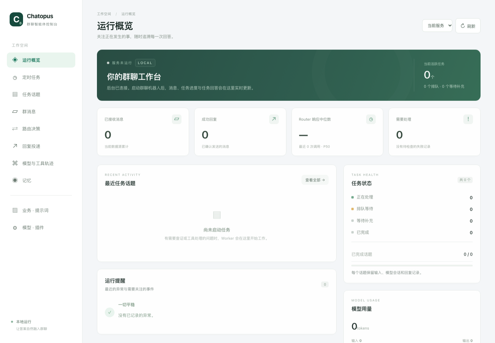
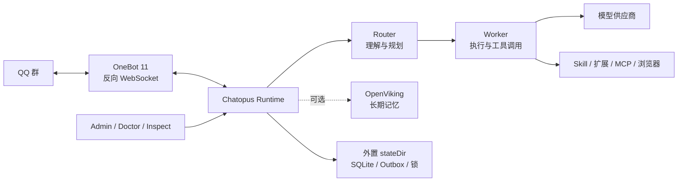

# Chatopus · 群聊八爪鱼

[](https://github.com/yougahu/Chatopus/actions/workflows/ci.yml)

**群里接话，背后开工。**

Chatopus 是一个自托管的群聊 Agent 运行时，受到 DeepSeek 团队 Super-agent 架构的启发：Router 持续接收群消息，判断是否回应、直接回答或分派任务；独立 Worker 使用模型和工具完成任务，再通过持久化 Outbox 投递结果。

它把群聊接入、请求理解、任务执行、长期记忆和可靠投递拆成可替换的边界。模型供应商、Skill、扩展工具和 OneBot 实现由部署者选择，源码默认保持通用。



*后台截图：默认空配置下的运行概览。真实部署中，这里会显示群消息、任务话题、路由决策、模型用量和投递状态。*

## 产品能力

| 能力 | 说明 |
| --- | --- |
| 群聊 Agent | 通过 OneBot 11 反向 WebSocket 接入 QQ 群，识别作者、群作用域、@、回复、图片和文件。 |
| Router + Worker | Router 判断是否回应、直接回答、追问、加入已有话题或分派任务；Worker 在独立上下文中执行模型和工具步骤。 |
| 可靠投递 | SQLite 持久化 Thread、Outbox 和投递回执，区分 `pending`、`sent`、`failed`、`unknown`，不对未知结果盲目重发。 |
| 可插拔能力 | Skill、扩展、MCP、浏览器和 Python 工具可以放在仓库外，由配置注册并按业务 profile 选择。 |
| 多房间业务 | 每个房间可以选择提示词、人格、能力和成员字段；默认配置不绑定领域知识。 |
| 可选长期记忆 | 通过 OpenViking 兼容服务保存可核对的成员画像和语义记忆，来源与访问范围由宿主控制。 |
| 定时任务 | 支持固定文字提醒和 Worker 任务，带角色权限、时区、执行窗口、补跑策略和独立投递记录。 |
| 本地控制台 | 后台查看运行概览、任务话题、消息、路由、模型与工具轨迹、记忆、用量、计划和配置。 |

## 核心架构



一次请求从 OneBot 进入后，运行时先按房间读取当前业务 profile，再由 Router 选择动作。简单问题可以直接回答；需要多步处理的请求会创建或追加 Thread，并交给 Worker。Worker 的每次模型调用、工具结果、任务状态和最终答复都写入持久化记录，Coordinator 通过 Outbox 负责后续投递。

这套边界让 Chatopus 可以更换模型和外部能力，而不把领域知识写进核心运行时：

- Router 负责判断意图、范围、作者归属、上下文和任务生命周期。
- Worker 负责在受限能力集合中执行计划，核对工具事实并生成结果。
- Coordinator 负责并发、取消、恢复、预算、状态持久化和投递。
- OneBot 适配器负责平台消息规范化和发送回执，不负责 QQ 登录或风控。
- 外部 Skill、扩展和 OpenViking 负责领域知识、检索与业务校验。

## 管理后台

后台是本地控制台，不是另一个聊天机器人。它可以独立于群服务运行，用于观察和配置：

- 运行概览：消息数、活跃 Thread、Router 延迟、模型用量和最近异常。
- 任务话题：从原始问题、补充条件到 Worker 执行、答复和发送结果的完整链路。
- 路由与群消息：查看静默、短答、追问、开题、追加和任务分派。
- 回复投递：区分确定成功、确定失败和无法确认的 `unknown` 状态。
- 模型与工具轨迹：查看实际调用、工具结果、最终答复和 Token 用量，不展示思考流。
- 记忆：按群和成员查看明确画像、来源、语义检索和本地摄取进度。
- 业务与模型配置：编辑 profile、人格、能力选择、Router/Worker 模型和唤起关键字。
- 定时任务：管理权限、计划、执行历史、用量和独立投递记录。

后台默认只监听 `127.0.0.1`，没有独立登录层。远程访问应通过 SSH 隧道或已经认证的反向代理，不能直接暴露到公网。

## 支持范围

Chatopus 主程序优先支持 **Linux x64、Linux arm64、macOS arm64**，CI 在这些目标平台上验证 Node、Python 离线测试、默认部署和干净源码导出。当前平台适配器是 QQ/OneBot 11，私聊和其他聊天平台尚未实现。

OpenViking 是可选后端，不属于默认安装。原生制品安装器同样优先支持 Linux x64、Linux arm64、macOS arm64，但需要部署者提供对应的 wheel、模型、Python 3.12 runtime 和哈希清单；详细限制见 [OpenViking 运维](docs/openviking-operations.md)。

## 快速开始

源码安装和外置部署目录的完整步骤见 [从零部署与运行](docs/deployment.md)。最短入口如下：

```bash
git clone https://github.com/yougahu/Chatopus.git chatopus
cd chatopus
npm ci
npm run setup -- --deploy-dir "$HOME/.local/share/chatopus"
```

安装完成后，用生成的 `chatopus` 启动命令运行 `doctor` 或 `admin`。模型、QQ、Skill、长期记忆和定时任务都可以在基础安装通过后按需启用。

## 文档入口

- [从零部署与运行](docs/deployment.md)：安装、配置、QQ 接入、常驻服务、备份、升级和排障。
- [管理后台](docs/admin.md)：页面、数据源、配置入口、审计和用量。
- [架构](docs/architecture.md)：Router、Worker、Coordinator、Thread、Outbox 和存储边界。
- [配置参考](docs/configuration.md)：模型、路径、环境变量、默认值和生效方式。
- [QQ 平台](docs/platform.md)：OneBot 接入、消息、附件和投递。
- [技能和工具](docs/skills.md)：外部 Skill、扩展、插件和浏览器能力。
- [可选长期记忆](docs/openviking-operations.md)：OpenViking 后端、平台制品和记忆维护。
- [验证方法](docs/verification.md)：离线测试、干净导出和可选集成验证。
- [发布清单](docs/releasing.md)：公开源码、依赖声明和发布前审查。

## 安全边界

`.env`、`config.local.json`、SQLite、Outbox、日志和聊天内容都属于私有部署数据。外部 Skill、扩展、插件和浏览器命令属于受信代码，加载前应审核来源、依赖、网络权限和文件权限。管理后台默认只提供本机访问，生产环境应限制允许的群并为 Router、Worker、OpenViking 使用职责明确的密钥。

## 许可证

本项目采用 [MIT License](LICENSE)。第三方依赖、模型、外部服务和 QQ 接入端仍受其各自许可证、服务条款和使用限制约束。
