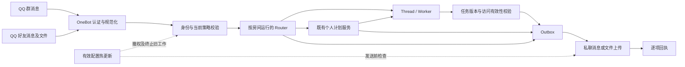

# QQ 私聊接入设计

状态：已实现并通过本地自动化验证；真实 QQ 桥接联调由部署者完成，尚未据此宣称生产桥接验收通过。使用方式见 [私聊说明](private-chat.md)，设计核对和验证边界见 [实施核对](private-chat-verification.md)。

修订日期：2026-11-19。代码基线：`b945d36`。目标：在 Chatopus 现有运行时中接入 QQ 好友与机器人的一对一私聊。

## 1. 设计结论

私聊复用现有 OneBot 反向 WebSocket、Router、Thread、Worker、SQLite、Outbox 和定时任务服务。首版包含文字、图片、文件收发、个人定时任务及私聊配置热更新；临时会话明确拒绝，不作为待开放能力。

| 决策 | 首版方案 |
| --- | --- |
| 接入对象 | 白名单中的 QQ 好友；普通消息仅接受 `private/friend` |
| 排除对象 | `private/group`、`private/other`、缺失或未知子类型；群临时会话不能凭白名单、群号或管理员身份绕过 |
| 默认配置 | 私聊关闭；空白名单不允许任何用户；允许以零接入目标启动 |
| 触发方式 | 私聊直接进入 Router，无需 @；群聊保持原唤起规则 |
| 作用域 | 群聊沿用 `qq:<botId>:<groupId>`；私聊使用 `qq:<botId>:private:<peerId>` |
| 身份数据 | 以完整 `roomId` 为准，结构化会话信息在运行时解析 |
| 热更新 | 私聊开关、用户白名单、输入限流和引用模式；在线撤权阻止后续工作与发送 |
| 文件 | 同会话文件输入、任务产物私聊交付；独立验证文件接口与逐文件回执 |
| 个人计划 | 固定提醒与 Worker 计划，复用既有计划、实例、命令、提案和调度器 |
| 权限 | 本人、本会话；不继承群管理员身份，不能指定其他私聊收件人 |
| 可靠性 | 区分任务完成、投递事实与结案；未知结果不自动重发，支持本人确认收到、放弃本次及明确补发 |
| 记忆与业务 | 沿用完整房间隔离及 `business.roomProfiles` / `defaultProfile` |

控制复杂度：不建立第二套调度器、持久化限流、用户公平调度、私聊默认业务层、通用渠道能力注册框架或进程心跳。在线撤权采用一个进程内私聊策略对象及异步操作失效标记；持久恢复复用现有状态、revision、epoch 和 generation，不新增权限表，也不把访问代次复制到所有业务记录。边界与崩溃处理见第 6 节。

## 2. 范围与当前代码

### 2.1 功能边界

首版支持直接短答、多轮追问、引用输入、多个独立任务、状态查询、取消、明确恢复及可选长期记忆。文件可以作为本会话任务材料，任务产物可以发送回本人；个人计划可以在未来向本人交付提醒或结果。

| 能力 | 首版边界 |
| --- | --- |
| 文件理解 | 宿主负责接收、校验、下载、明确绑定及有限保留；格式解析依赖当前可用工具，不保证能理解所有文件格式 |
| 个人定时任务 | 支持创建、查询、修改、暂停、恢复、立即执行、停止本次、取消、归档；时间规则沿用现有服务 |
| 配置管理 | 编辑现有配置文件后自动应用私聊热字段；后台显示保存值与最近应用记录，不新增独立配置编辑系统 |
| 临时或陌生人会话 | 明确拒绝；不自动转成好友会话，不发送引导回复，不自动同意好友 |
| 跨用户或群共享 | 不共享历史和记忆，不转移任务，不代另一用户登记计划或向其推送 |
| 语音、视频等其他输入 | 给已授权好友明确的能力提示；不把内容占位符当成已理解的材料 |
| 资源控制 | 简单内存输入限流与现有全局并发、步数、超时和计划额度；不增加个人公平调度 |

典型体验：用户发文件并说“提取要点”，系统在当前任务中处理并可返回结果文件；用户说“每周一九点提醒我检查资料”，确认时间与内容后建立本人计划。移出白名单的变更应用后，未完成工作终止、个人计划受阻；重新加入不会自动复活旧工作或补发结果。

### 2.2 改动前基线与实施范围

| 模块 | 当前实现 | 必要改动 |
| --- | --- | --- |
| [platform/onebot.ts](../src/platform/onebot.ts) | 群消息收发、群文件上传；构造器要求非空群列表 | 好友消息、文件事件、私聊发送及文件上传；每次平台操作检查当前策略 |
| [activation.ts](../src/activation.ts) | @ 或称呼唤起 | 可信私聊直接参与；不伪造 `isMentioned` |
| [coordinator.ts](../src/coordinator.ts) | 房间队列、版本控制、取消、逐文件投递 | 私聊所有权、在线撤权、控制命令、投递状态、明确补发及人工结案 |
| [dsh-runtime.ts](../src/dsh-runtime.ts)、[protocol.ts](../src/protocol.ts) | 群聊提示词与动作契约 | 会话参与说明、文件材料、个人计划、无消息回调和宿主动作校验 |
| [store.ts](../src/store.ts)、[router-session-store.ts](../src/router-session-store.ts) | 房间归属、事务与 Router generation；数据库版本 2 | 撤权事务、恢复过滤、文件元数据与来源/显示引用分离、版本保护 |
| [config.ts](../src/config.ts) | QQ 配置是启动快照；业务已有热加载 | 私聊热字段与应用失败收敛；附件保留和容量配置校验 |
| [scheduled-tasks/host.ts](../src/scheduled-tasks/host.ts)、[policy.ts](../src/scheduled-tasks/policy.ts) | 依赖群范围、群角色和固定 `allowedRoomIds` | 私聊本人策略、动态范围、文件绑定、交付截止时间及补充后恢复 |
| [memory/shared-memory.ts](../src/memory/shared-memory.ts) | 完整房间账号与成员资料 | 私聊成员集合及在途撤权检查，复用现有隔离 |
| [admin/schedules.ts](../src/admin/schedules.ts)、[admin/server.ts](../src/admin/server.ts)、[admin/app.js](../src/admin/app.js) | 本地运营控制台 | 私聊筛选、个人计划、配置应用记录、逐文件和整体投递状态 |

## 3. 会话模型与总体流程



### 3.1 唯一作用域来源

新增小型 `src/conversation.ts`，集中解析和构造 QQ 作用域。以下对象仅是运行时解析结果：

```ts
type QqConversation =
  | { kind: 'group'; botId: string; groupId: string }
  | { kind: 'private'; botId: string; peerId: string };

declare function parseQqRoomId(roomId: string): QqConversation | undefined;
declare function formatQqRoomId(conversation: QqConversation): string;
```

| 对象 | 规则 |
| --- | --- |
| 群会话 | `qq:<botId>:<groupId>`，兼容旧格式 |
| 私聊会话 | `qq:<botId>:private:<peerId>` |
| 普通消息 ID | `<roomId>:<platformMessageId>` |
| 文件通知 ID | `<roomId>:file:<eventKey>`，仅为宿主 ID，不伪造可引用的平台消息 ID |
| 引用消息 | 平台消息 ID 与当前完整 `roomId` 联合解析 |
| Thread、run、schedule | 沿用宿主生成的唯一 ID，操作时再检查 room 与 owner |
| 记忆与附件缓存 | 完整会话、来源消息和附件序号共同限定 |

机器人、群、用户 ID 为规范十进制字符串；数字输入要求安全整数。平台消息 ID 保留既有有符号整数规则。真实输入的 bot 必须等于认证身份，私聊 peer 必须等于作者。

`GroupMessage` 可更名为 `ChatMessage` 并暂留别名；无需重写旧 JSON。输入附件由单一图片类型扩展为图片/文件联合类型，文件记录宿主来源键、原始显示名、声明字节数、桥接文件标识及下载状态；本地路径和实际大小/摘要由宿主下载后写入。文件通知需显式区分“无平台消息 ID”，引用序列化只能使用经过验证的真实 ID。

不持久化重复的 `conversation`、bot/peer 身份。Router/Worker 从 room 派生说明，包括 `messages=[]` 的结果回调。CLI/replay 保持本地身份规则；真实 QQ 入口不把未知 room 格式默认为群。

### 3.2 宿主边界

身份、目标、文件来源和计划归属由宿主绑定；模型不能自行指定。平台差异集中在适配器及少量现有入口判断，不预建多渠道插件体系。业务知识、工作流及文件解析能力由 profile、Skill 和扩展提供。

## 4. 配置与热更新

### 4.1 配置定义

以下是拟议片段，账号均为合成值。现有 token 环境配置继续使用；个人计划另受现有 `scheduledTasks.enabled` 总开关约束。

```json
{
  "qq": {
    "enabled": true,
    "selfId": "100001",
    "allowedGroupIds": [],
    "privateChat": {
      "enabled": true,
      "allowedUserIds": ["200001", "200002"],
      "maxMessagesPerMinute": 30,
      "replyMode": "plain"
    }
  },
  "scheduledTasks": {
    "enabled": true
  },
  "attachments": {
    "retentionDays": 7,
    "maxStorageBytes": 10737418240,
    "minFreeDiskBytes": 536870912
  }
}
```

| 字段 | 默认与校验 | 生效方式 |
| --- | --- | --- |
| `privateChat.enabled` | `false`，布尔值 | 热更新；关闭即撤销所有私聊准入 |
| `privateChat.allowedUserIds` | `[]`，去重的规范 QQ ID，最多 1000 项，无通配符 | 热更新；移除即撤权，添加只允许新工作 |
| `privateChat.maxMessagesPerMinute` | `30`，整数 1–600 | 热更新；保留当前窗口计数，降低后可能立即限流 |
| `privateChat.replyMode` | `plain` 或 `quote`，默认 `plain` | 仅新 Outbox 使用新值，已生成载荷不变 |
| QQ 身份、凭据、监听、群列表及 `qq.enabled` | 沿用原配置 | 重启生效；不纳入本次私聊热更新 |
| `scheduledTasks.enabled` 及既有调度参数 | 沿用原配置 | 沿用现有生效规则；本次不扩大为所有配置热更新 |
| `attachments.retentionDays` | `7`，整数 1–3650，释放有效引用后的保留天数 | 重启生效；仅管理第 7.7 节登记的附件 |
| `attachments.maxStorageBytes` | `10737418240`（10 GiB），安全整数且至少 20 MiB | 重启生效；附件实际占用与在途预留合计上限 |
| `attachments.minFreeDiskBytes` | `536870912`（512 MiB），非负安全整数 | 重启生效；写入后需保留的磁盘可用空间 |
| 业务绑定、提示词与已支持的业务字段 | 沿用现有格式 | 沿用原热加载规则 |

未知私聊字段报错；没有临时会话开关。`qq.enabled=true` 时仍校验身份、token 和传输参数，但不再要求“至少一个允许群或私聊已开启”。群为空且私聊关闭/白名单为空时，允许启动、连接并完成本地恢复清理，状态明确为“允许 0 个目标”。这也是只私聊部署关闭功能后清理旧队列的途径。

业务选择直接复用 `business.roomProfiles[roomId]`，否则使用 `defaultProfile`；绑定不授予接入资格。不增加 `privateDefaultProfile`。

### 4.2 加载与应用

一个随服务生命周期启停的轮询器每秒检查配置文件，读取到变更后完整解析 JSON、校验私聊字段、规范化并比较私聊配置摘要。不要依赖文件监听器每次都能收到事件，也不在每条消息或每次工具调用中读磁盘。读取与应用串行化，较早读取的候选不能覆盖较新的已应用值；每次只应用实际完整读到的有效快照。

修改到生效通常在下一轮检查，事件循环阻塞时可能更晚，不承诺硬性一秒 SLA。私聊字段不变且没有待完成清理时无需触发撤权；存在应用失败时，即使文件摘要未变也必须继续第 6.5 节的收敛处理。调整限流或引用模式不取消任务。跨多个字段的变更作为一个快照应用，不出现新白名单搭配旧开关。

若配置中的 `selfId` 已改成另一机器人，不把该候选私聊白名单应用到旧机器人，报告 `restart_required`。其他需要重启的字段保留启动值并提示；私聊热字段在当前身份下独立应用。业务加载与私聊策略不共用可变对象，避免旧的 `reloadAgentConfig` 意外覆盖或绕过生效策略。

### 4.3 错误与确认语义

- 启动时配置无效：启动失败，不取消历史任务。
- 运行中 JSON 损坏、文件暂时不可读、字段无效：拒绝候选，保留最后有效私聊策略，记录脱敏错误；不将临时文件故障解释为正式撤权。修复后下一轮自动重试。
- 合法的关闭或空白名单：是正式撤权，必须执行第 6 节清理，不能当作无效配置忽略。
- 保存文件不等于已应用；只有撤权事务提交并切换快照后才记录 `private_config_applied`，包含私聊摘要、应用时间、当前 bot 与数量，不包含 token 或完整配置。
- 磁盘修改后立即又改回且从未被服务读到，不视为发生过撤权。紧急操作需核对应用记录，必要时停止服务。

不新增配置历史表或心跳协议。后台可展示磁盘快照与最近应用记录是否一致，但还需展示该应用记录之后未被成功应用记录结算的错误；摘要相同不代表失败清理已经完成。“最近应用”不能表述为当前进程仍在线；服务离线时只显示待运行服务应用。

## 5. 输入、对话与任务控制

### 5.1 接收顺序与临时会话拒绝

普通消息按 [OneBot 11 消息规范](https://github.com/botuniverse/onebot-11/blob/master/event/message.md) 分类，只有 `message_type=private` 且 `sub_type=friend` 可以成为私聊输入。

1. 验证反向 WS 的 Bearer token、路径和 `X-Self-ID`，事件 `self_id` 必须一致。
2. 校验事件类型、结构、作者与 ID，忽略机器人的发送回显。
3. 先拒绝临时、陌生人、缺失或未知子类型，再检查当前已应用的开关与白名单。即使 peer 已在白名单或好友缓存中，`private/group` 也不能被提升为 `friend`；不能根据 `group_id` 构造另一条回复路径。
4. `sender.user_id` 如存在需匹配顶层作者。私聊 `isAdmin=false`、群角色 `unknown`，不信任附带的群管理员字段。
5. 规范化文字、图片、引用及已验证的文件事件；CQ 样式文本仍是文字。文件通知的额外身份约束见第 7.4 节。
6. Coordinator 先持久化去重检查，再限流和入库；授权检查到入库之间没有异步间隙。附件下载在接纳后按需进行。

拒绝的临时会话与未授权事件不保存正文、不下载附件、不调用模型、不建立任务或记忆，也不发“请加好友”等回复；只累计有界原因计数。缺少 subtype 的文件通知只有第 7.4 节明确验证的事件契约可以进入，不能成为通用绕过入口。

### 5.2 参与与所有权

私聊直接参与但 `isMentioned` 保留平台事实。调整早退、错误反馈、动作过滤、显式任务标志、计划授权来源及续接；群聊闲聊冷却不阻止连续私聊。Router 可以短答、澄清或建立 Worker 任务，无需每条消息启动 Worker。

任务绑定 `ownerId=peerId`；查询、追加、取消、恢复与重发结果要求同一 room 且本人拥有。引用优先使用本地绑定；多个候选任务时澄清，不能盲选最近任务。继续保留 revision、epoch、输入序号和 `coveredInputSeq` 校验。

有实际文件但没有文字仍是有效输入；未说明用途时询问如何处理，不自动运行文件。完全空消息不调用模型。内容类型或解析能力不支持时明确说明已收到什么、无法处理什么，不能宣称读过文件。

### 5.3 限流下仍可取消和查询

普通输入使用进程内 Map，按 room 统计最近 60 秒接纳数，最多保留 600 个时间点；仅授权用户建立记录，空闲记录回收。重复事件、已接纳输入恢复不重复计数，重启清空计数。

超限输入不进入 Router、正文历史或附件下载。每个 room 每 60 秒至多生成一条宿主限流提示，通过现有 Outbox、时间窗去重键发送；提示不包含被拒绝正文，遇到 `unknown` 不重发，并受撤权检查。

提供无需模型的精确控制格式：`/status [任务ID]`、`/cancel [任务ID]`、`/schedule list`、`/schedule pause <计划ID>`、`/schedule stop <计划ID>`、`/schedule cancel <计划ID>`。控制输入有独立的 10 次/60 秒内存上限，不消耗普通额度；其他任意自然语言不能冒充控制命令。未给任务 ID 且候选不唯一时列出本人候选并要求选择，不批量取消。状态/取消走现有宿主校验及幂等处理，不绕过授权、同会话或系统计划边界。

投递核对提供 `/delivery list`、`/delivery received <投递ID> [项目ID]` 和 `/delivery abandon <投递ID> [项目ID]`，共用上述控制额度。查询展示本人的待处理投递、原计划/任务、文件项目及操作含义；未指定项目时，received 针对该交付全部待确认项，abandon 针对全部尚未处理完的项目。具体权限、部分结案与确认规则见第 7.8 节。

自然语言控制仍可由 Router 处理；限流提示给出精确命令，避免正在运行的任务只能等普通窗口恢复后才能停止。普通任务和计划继续共用现有全局并发、步数、超时与互斥，不增加第二套资源额度。

## 6. 在线撤权、恢复与重新加入

### 6.1 最小运行时策略

服务持有一个当前私聊快照，适配器、Coordinator、计划宿主与记忆后台读取同一对象。对当前允许的 room 按需分配进程内有效标记（例如不透明 token 和 AbortSignal）；被移除时使旧标记永久失效，重新加入分配新标记。未变化的用户保留标记。

接纳输入、启动 Router/Worker、计划执行、文件下载和记忆后台操作时捕获标记。任何异步操作返回后，以及提交动作、结果、记忆写入或平台发送之前，检查标记仍有效，并复核对应持久记录及原有版本。不能在回调中直接领取“当前新标记”，否则删除后立即加回会放行旧工作。闭包外排队的工作携带原标记；重启恢复则只为通过恢复校验的非终态记录新建标记。

标记只封锁本进程晚到回调，不写入所有业务表。跨重启依靠第 6.2 节的持久终态；单实例锁保证只有一个服务执行模型和投递。若以后允许多个执行进程或分布式队列，需要重新设计这一前提。

### 6.2 应用撤权

对移除用户或关闭私聊的候选，先暂停这些 room 的新接纳与派发、使旧标记失效，并将它们加入进程内待清理集合，再在现有 SQLite 事务中清理工作。事务内无异步调用；清理提交后切换策略并写入应用审计。数据库清理失败时保持受影响 room 暂停、报告应用失败并重试，不报告成功或恢复旧标记；群与未受影响私聊继续按有效状态运行。配置随后修改或回滚时按第 6.5 节处理，不能丢弃待清理集合。

| 对象 | 撤权事务及紧随其后的处理 |
| --- | --- |
| pending/processing 输入 | 置 `failed`，原因为 `private_access_denied`，阻止自动重放 |
| pending Router turn | 置失败，推进既有 Router 会话 generation 并标记重建；事务失败则不可接纳其旧提交 |
| queued/running 普通任务 | 置 `cancelled`、递增 epoch、清除 active run，结算中断执行 |
| pending Worker result | 标记 `stale`，禁止再生成交付 |
| 未尝试 Outbox 及尚未尝试文件项 | 标记 `stale`，保留原结果与原因；包括短答、澄清、错误及限流提示 |
| 正在发送的消息/文件项 | 不改写为确定未发送；等待实际回执，无法确认或进程中断则 `unknown` |
| 私聊计划 | 未结束计划置 `blocked/private_access_denied`，递增既有 generation，取消在途实例；已结束计划仅结算尚未完结交付 |
| 计划命令与提案 | 该 room 的 pending/proposed 请求拒绝或作废；包括尚未创建计划的提案 |
| 记忆与文件后台工作 | 停止派发并请求中止，晚到结果不能提交；不删除历史或已接纳材料 |
| sent/failed/unknown 历史 | 保留事实回执，不伪装为成功撤回 |

事务提交后发送取消信号，释放已中止的运行资源。取消是尽力中止；真正的提交许可来自标记和记录版本检查。已交给桥接端的消息/文件以及已经发出的远端记忆写入可能完成，不能承诺撤回；回执仍记事实，但不得据此发送后续项目或衍生动作。记录已发生尝试的最终回执不受旧标记失效阻止；它只能更新原尝试的事实，不能恢复任务或取得新提交许可。

发送前可异步读取文件、解析引用，但在最后一次有效性检查、登记发送尝试和 WS 写入之间不得出现 `await`。适配器可通过构造注入的检查函数/既有发送包装完成校验，维持 `PublisherPort.send(message, dedupeKey)` 与 `uploadFile(roomId, file, dedupeKey)` 主契约。连接尚未可写时只能 `deferred`，不能绕过撤权后继续发送。

### 6.3 启动恢复

```text
加载并验证配置
  → 获取实例锁、打开数据库并检查版本
  → 将未结算 sending 尝试恢复为 unknown
  → 按当前配置清理不允许的私聊工作与计划
  → 恢复允许的非终态记录并分配进程内标记
  → 启动配置轮询、接收与派发
```

本地恢复准备与等待历史 Router 完成分开：准备完成即可开放监听；清理之前不能启动 tick、记忆摄取或接纳事件。零目标配置也执行这套准备。机器人身份变更后，旧 bot 的私聊不可执行。清理事务可重复；已提交清理不会因随后监听失败而撤销。

### 6.4 重新加入

重新加入后允许新消息，读取同会话已有历史。被作废的输入、turn、结果、Outbox、计划命令和实例不自动恢复。用户明确继续普通任务时使用新输入、新 run 与更新的 epoch；重新建立的工作不能复用被撤权作废的交付。

个人计划保留 `blocked`，必须本人或后台明确恢复；恢复时重验授权、计划版本、业务能力与时间有效性。循环从恢复后的下一个有效时刻执行，不补跑撤权期间的周期；过期单次计划需要修改时间或重建。已失败或不确定的历史投递不随计划恢复重发。

已合法接纳历史可由新的记忆后台操作继续摄取；旧操作标记不复活。无论删除和加回发生在同一进程还是跨重启，都遵守上述规则。

### 6.5 应用失败后配置改回的处理

策略对象除已应用快照外，只维护“最近有效候选”和“已经使旧标记失效、尚未完成清理的 room 集合”。待清理集合独立于配置摘要，轮询每轮都检查；数据库暂时不可写时在后续轮次重试，不在同一轮忙等。

例如 A 原本获准，移除 A 的清理事务失败，运营者又把 A 加回：

1. 以新读到的有效候选替换旧候选，但保留 A 的待清理记录和暂停状态。无效候选不覆盖最近有效候选，也不重新启用旧标记。
2. 先完成 A 已开始的旧工作清理；即使最新候选与已应用摘要完全相同，也不能跳过。这样旧 Router、任务和计划提案不会借配置回滚恢复。
3. 清理提交后按最近有效候选决定准入。若允许 A，则分配新标记并解除接入暂停；已取消任务、受阻计划和旧 Outbox 仍按第 6.4 节处理。若仍不允许，则保持拒绝。
4. 将本次清理完成与最终快照一起记录为成功应用，即使摘要未变也产生新的应用时间；成功记录结算先前应用错误。不能重新应用已经被替换的整份撤权候选，影响最新候选中的其他用户。

这一集合仅用于当前进程故障收敛。若清理未提交就崩溃，重启按当前磁盘有效配置和数据库已提交状态恢复；未提交撤权不宣称已生效。若清理已提交，重启不能回滚终态。无需为失败中的配置编辑历史增加权限表。

## 7. 输出、文件与可靠投递

### 7.1 目标与来源关联

| 内容 | 平台动作 | 目标 |
| --- | --- | --- |
| 群文字/图片 | `send_group_msg` | 原群授权与 @ 逻辑 |
| 私聊文字/图片 | `send_private_msg` | 仅 room 中的 `peerId` |
| 群文件 | `upload_group_file` | 原群文件路径 |
| 私聊文件 | `upload_private_file` 扩展接口 | 仅 room 中的 `peerId`，不复用群 ID |

私聊非空 `recipientIds` 是非法输出，宿主拒绝，不能静默删除后发送；模型、文件名、引用和工具输出均不能改目标。不支持临时会话所需的群路由参数，失败不回退群聊。

发送前检查好友身份仍可核验：已认证的近期 `friend` 输入或好友列表可提供最多 60 秒的证据，过期则通过桥接刷新。查询暂时失败且尚未发送时为 `deferred`；明确已非好友时拒绝交付，个人计划置 `blocked/friend_unavailable`，不能降级成陌生人或临时发送。好友核验的异步等待之后仍须重新检查访问标记与任务版本；缓存重连清空，不把白名单当成好友关系证明。

`send_private_msg` 的标准成功回执含消息 ID，见 [OneBot 11 API](https://github.com/botuniverse/onebot-11/blob/master/api/public.md#send_private_msg-发送私聊消息)。文件上传属于实现扩展，不能据此推断其返回字段。

### 7.2 宿主来源与显示引用分离

`OutgoingMessage.replyToMessageId` 继续保存宿主确认的来源平台消息 ID；新增可选 `quoteReply` 控制是否生成 wire `reply` 段。旧群消息未设置该字段时保持原行为，私聊入 Outbox 时固定为 true/false。不能为了 `plain` 删除来源 ID：`prepareReplyPreferences`、引用链和审计仍需使用它。

Worker 答复绑定 `coveredInputSeq` 所覆盖的输入；短答、澄清、错误和计划回执同样保存来源，并复用 thread/associationThreadId。来源只有文件通知内部 ID 时，在 Outbox 元数据记录 `sourceInputId`，不要把它填进可发送的平台 ID；相应查询支持内部来源回查。一次计划触发另用 `scheduleRunId` 表示来源，默认不引用很久以前的创建消息。

输入引用只查本地同 room、接纳边界内的记录；查不到时请用户补发，不凭裸 ID 调用 `get_msg` 注入未知归属内容。引用不支持时配置 `plain`；已生成 Outbox 不因热改模式、重试或重启变更载荷。图片沿用可信下载、格式、字节上限及不可变产物验证。

### 7.3 通用回执

| 情况 | 状态与处理 |
| --- | --- |
| 本地身份、目标、版本或输出验证失败 | `failed` 或尚未尝试工作 `stale`，不可重试 |
| 连接不可用且未尝试 | `deferred`，不消耗发送次数，后续重验权限 |
| 平台明确证明未执行 | `failed`，仅已验证的错误分类允许有限重试 |
| 消息成功并返回真实消息 ID | `sent`，保存回执 |
| 已尝试后超时、断线、异步受理或不确定响应 | `unknown`，不自动重发 |
| 消息成功但没有有效消息 ID | `unknown`，不虚构 ID |
| 同去重键不同目标、内容或附件 | 拒绝第二次发送 |

将私聊消息和文件动作加入现有“可能已执行”的错误分类；不能将未知业务错误当成可安全重试。调用前持久化尝试，崩溃恢复保持不确定事实；不承诺平台 exactly-once。

### 7.4 输入文件

接收契约明确区分两种来源：经过验证的 `private/friend` 消息中的文件段，以及桥接实现的好友文件通知。后者不是 OneBot 11 基础消息的通用保证；例如 [go-cqhttp 文件通知](https://docs.go-cqhttp.org/event/#接收到离线文件) 定义了 `offline_file`、发送者、文件名、大小和 URL，不能假设一定有消息 ID、file ID 或 friend 子类型。

通知入口只为已验证的桥接实现/版本启用：其契约必须能确定事件来自好友文件传输，且通过认证桥接的 `get_friend_list` 再核对当前 peer 是好友（共享最多 60 秒缓存，重连清空，查询失败不接纳该通知）。仅有白名单、旧聊天记录或一个任意 URL 不足以证明好友来源；无法区分临时来源的事件形态拒绝接纳，不能用好友列表把明确临时事件改类。

每个部署固定一种文件主上报来源；若桥接同时发送文件段和通知，使用稳定源 ID 合并，或忽略非主来源，不能创建两份任务。通知无稳定 ID 时，用 room、平台事件时间、名称、大小与传输标识/URL 摘要生成宿主去重键，不包含接收时间；重复同一事件只入库一次。这只承诺相同规范化事件幂等，无法证明不同上报是同一文件时不猜测合并，版本验收需覆盖实际重放行为。

输入处理规则：

1. 先验身份、准入、去重与限流，再保存附件元数据；不在未授权事件上探测 URL。原始 URL/桥接标识只留在受控存储，不进入模型正文或诊断。
2. 文件限额与现有输出一致：单文件 10 MiB、一次输入最多 4 个、合计 20 MiB；实际流式字节数也必须检查。非安全整数、负大小、超限、异常名称明确拒绝，不能只信声明大小。
3. 宿主按同会话来源解析文件，提供小型下载入口供任务使用；工具只接受宿主附件 ID，不接受模型传入的任意下载地址或本机路径。已有已验证 URL 可下载，需桥接解析时仅使用已接纳来源的文件标识。
4. 网络下载限制 60 秒和最多 3 次重定向；仅允许部署桥接已验证的文件来源，逐跳检查协议、地址和大小，拒绝回环/内网探测。本地桥接返回路径不能直接读取；仅显式配置的受控缓存根可读，检查 realpath、普通文件与非符号链接。不能照搬图片专用扩展名规则阻止普通文档。
5. 写入任务内受控附件目录，宿主生成路径，显示名不能穿越目录；保存实际 bytes 与 SHA-256，完成后原子提交元数据。下载超时、失效、限额或取消时清除临时文件；撤权后不挂入任务上下文。重启清理孤立临时文件；正式快照按第 7.7 节明确的保留规则管理。
6. 下载失败保留可诊断状态，提示重传；需要用户再次触发才重试已失败下载。文件内容视为用户材料，不自动执行脚本、解压或运行宏。解析能力缺失或读取失败明确返回，不能用文件名猜内容。

输入下载是本机接收操作，不使用发送的 `unknown` 语义。任务只可读取当前授权来源和同一任务的附件；跨房间文件 ID、缓存路径和同名文件均不能扩大访问范围。用户明确选用同会话已有文件建立新任务或计划时，宿主校验来源后将选中的快照绑定到新执行；不开放旧任务目录浏览权限，计划文件绑定见第 8.5 节。

### 7.5 文件交付与部分成功

私聊开放既有 `artifact_publish`，继续由宿主校验任务归属、冻结文件产物、名称、路径、bytes 与 SHA-256；沿用 [output-files.ts](../src/output-files.ts) 的单文件 10 MiB、最多 4 个、合计 20 MiB 限制。不能让模型直接把任意本机路径交给平台上传。

复用 `PublisherPort.uploadFile` 和 Outbox 的 `fileDeliveries`，仅在适配器选择私聊动作。`upload_private_file` 的公共参数基础为 `user_id`、`file`、`name`，见 [扩展 API](https://docs.go-cqhttp.org/api/#上传私聊文件)；该参考要求桥接可读的本地文件，不足以证明其他实现支持 base64。部署适配须固定并测试一种传输方式：现有 base64 路径仅用于明确支持的实现，否则使用受控共享目录。不能先试一种有副作用的上传，超时后自动换方式再发。

文件成功条件按经过验证的部署契约判断：若契约提供 file/message ID，校验并保存；若明确约定同步上传完成但没有 ID，可返回 `sent` 并保留动作/成功码，ID 留空。仅一个未经验证的 `ok`、空对象、`null` 或异步受理不构成成功证据，应为 `unknown`。当前 `call()` 要求响应 data 为对象，需按动作处理已验证的空响应契约，不能放宽所有 API 的验证；不能机械复用群文件“必须有 file_id”的判断或伪造文件 ID。

每个文件单独登记尝试、使用独立去重键并保存结果，已 `sent` 项不重复上传；`unknown` 项停止自动继续。每上传下一项和发送正文前重验权限、任务与计划版本。文件全部成功且正文/图片也成功才是整体完成；中间失败、未知或撤权时保留已成功项，明确显示“部分交付”，不把已传文件说成已撤回。相关提示不再使用“已上传到群”等群专属文案。

仅有文件的输出允许成功完成，无需强造空文字消息。文件接口不可用应明确报告，不能丢掉附件后把正文送达计为完整成功。

### 7.6 状态查询与明确补发

`request_status`、精确状态命令和后台同时展示执行与投递：排队、运行、待补充、结果已生成待投递、已投递、部分投递、投递失败、投递不确定、投递已过期、已取消/失效，并另列“待核对、本人确认收到、已放弃、补发已完成”等结案状态。不能仅凭 Thread 为 `idle` 就回复“已回答”；计划实例同样区分执行状态与 deliveryStatus。“已投递”表示桥接确认发送成功，不表示用户已读；人工结案也不改写平台事实。

用户说“再发一次”时只选择同会话、本人所有且仍有效的结果；存在多个候选必须澄清。若原投递仍 pending/sending，不创建竞争投递，先报告状态。已撤权作废、被更正取代或文件已丢失的结果不可直接补发；解释原因，重新执行需单独请求。

确定失败的结果可在明确请求后补发；`unknown` 先说明可能已送达，并要求用户确认“仍然补发”。补发创建新 Outbox、新去重键，按当前输入 ID 幂等，并关联原投递；原回执不覆盖，Worker 不自动重跑。默认仅补发未确认送达项目，已成功项不重复；用户明确要求完整再发时才建立完整新副本。内容与附件重新校验，当前引用模式只作用于新副本。

同一原交付至多存在一份活动补发；宿主保存新旧 Outbox 关联及项目映射。补发成功后按第 7.8 节结案所覆盖的原待处理项，不能只新增一条成功记录而让旧 unknown 永久阻塞计划。补发失败或再次 unknown 时继续等待处理；结案后再次索取历史结果属于新的用户交付请求，不重新打开旧结案或占用原计划实例的互斥。

已经超过定时交付截止时间的 Outbox 不能重新入队。用户仍可主动请求查看同会话的历史结果：宿主重新校验所有权、结果有效性和附件可用性，创建关联原结果的新回复并标明原计划时间；不改变旧投递的过期事实，也不把旧提醒伪装成当前到期提醒。

### 7.7 附件保留与磁盘空间

本次增加明确的附件保留规则，不假定当前仓库已有任务目录自动清理。范围是本功能登记的输入快照、计划绑定快照、运行所需副本、输出交付快照及宿主管理的上传暂存文件；不递归删除整个 Worker 工作目录，也不清理旧群文件、用户自建文件或桥接进程自身缓存。

默认在最后一个有效引用释放后保留 7 天，之后由持锁服务启动时及每小时清理。未被引用过的已完成下载从完成时间起算；普通查询不刷新期限。有效引用由现有任务、计划、命令和 Outbox 的状态决定：

| 引用方 | 保护期间与释放时机 |
| --- | --- |
| 普通任务 | queued/running/needs_input 期间保护；完成、失败或取消且无待投递引用后释放 |
| 个人计划 | active/paused/blocked 且未超过有效期、次数上限的当前文件绑定受保护；明确移除文件、取消或结束后释放。暂停或撤权受阻不等于删除材料 |
| 计划命令、提案与实例 | 有效 pending/proposed 命令及 queued/running 实例保护各自快照；作废、过期或结束后释放，不影响仍使用旧快照的在途实例 |
| Outbox 与上传 | pending、实际 sending 及仍允许重试的投递保护附件；sent、终态 failed/stale 或已结算 unknown 后开始保留期。未知回执不自动续期或重传 |

一个文件有多个引用时必须全部释放才开始计时；恢复计划、明确继续任务或新建补发时先确认快照尚在，再建立新引用。文件已经清理则标记 `attachment_expired` 并请求重传，不能改用同名文件；消息元数据、摘要、原始来源和发送事实仍保留。文件替换和计划恢复都重新检查内容摘要。

宿主登记 `createdAt`、最后引用释放时间、bytes、SHA-256 与本地可用状态，复用消息/计划/结果 JSON 元数据及受控目录。清理与建立引用串行协调：删除前再次确认无引用，标记为正在清理后不再绑定，删除成功才标记 expired；文件仍被读取或上传时不得删除。进程崩溃后重新核对标记和文件存在性，临时文件与无引用的孤立副本可清理，不能仅凭文件 mtime 判断是否过期。

附件总占用默认上限 10 GiB，并要求写入后至少剩余 512 MiB 磁盘空间。下载、复制计划快照和生成输出交付快照前，以最大可能写入字节预留空间；同一进程的并发预留计入额度，实际字节增加不能绕过限额。重启从受控目录重建占用，物理副本分别计费；不建设跨会话内容去重系统。

容量不足时先清理已到期且无引用的文件，仍不足则拒绝新增文件写入，返回 `attachment_storage_full`，保留可处理的文本与既有文件。不能通过删除受保护文件或尚在保留期的材料腾空间，也不能静默丢掉本次必要附件后声称任务完成。操作系统写入失败同样清理临时文件、释放预留并报告；这是附件范围的容量保护，不承诺限制受信 Worker 脚本在其他目录的写入。

### 7.8 不确定投递的核对与结案

结案回答“这份交付是否还需要处理”，平台回执回答“平台是否确认发送成功”，两者分别保存。适用于私聊普通结果和个人计划结果；消息正文与每个文件分别核对，原 Outbox、发送尝试及逐文件 `sent/failed/unknown` 事实不因人工操作而覆盖。

| 入口 | 结案结果 | 限制与用户反馈 |
| --- | --- | --- |
| 用户明确“我已收到”或 received 命令 | `confirmed_received`，记录本人确认及其来源消息 | 只关闭明确对应的待确认项目，不虚构平台消息 ID；不能把尚未发送的其他文件一并标为已收到 |
| 用户明确“这次不用补发”或 abandon 命令 | `abandoned`，关闭指定项目并作废其尚未发送的补发/剩余项 | 表示不再处理这些项目，不代表确定未送达，也不取消整个计划 |
| 经明确请求建立的补发收到真实成功回执 | `resent`，由宿主自动记录对应补发 Outbox | 仅结案已确认送达的对应项目；其他失败、未知或未发项目仍需处理，模型不能自行声明补发成功 |

自然语言入口由 Router 将当前明确输入转换为受限 `resolve_delivery` 动作，携带 `sourceMessageIds`、`outboxId`、可选项目 ID、received/abandon 决定及 `expectedResolutionVersion`；目标和版本必须来自宿主查询。可选 `resumeSchedule=true` 仅用于用户同条输入明确要求恢复该交付所属计划的情况，默认 false，不能另填计划目标。补充一个同会话的投递查询入口，供 Router 获取目标及当前版本；不让模型查询任意 room、owner 或伪造回执。只说“谢谢”、引用一条无关消息或语义不明确时不能自动结案；多个候选时列出摘要、时间和项目供用户选择。精确命令可直接执行已明确的整份或指定项目操作，不额外要求重复确认；自然语言没有明确覆盖范围时先澄清。

用户必须仍是当前获准好友，且是同一 room 的交付所有者。普通短答没有 Thread 时，从可信来源输入确认作者；个人计划核对 user authority、owner 和实例归属，QQ 用户不能结案系统计划。本地后台可按原管理权限核对用户或系统交付，记录管理员身份，不冒充本人确认。计划总开关关闭时仍可核对已有回执，但结案不会启用计划或发消息；私聊准入限制仍适用于 QQ 用户。

实际发送尚在进行时，不允许结案或补发掩盖该尝试，应反馈“正在发送，请等待回执”。只要原交付或关联补发中仍有实际 sending，就暂不接受该交付的结案；超时已结算为 unknown 后才可核对。事务中再次检查当前尝试、结案版本和关联补发：人工结案使覆盖项目的尚未发送补发失效，投递前的版本检查据此阻止它继续发送；未覆盖的项目保留原状态。已经送到平台的内容不能撤回。

同一份交付可部分结案。例如文件 A 为 unknown、文件 B 尚未发送，用户确认 A 后只记录 A 的确认，仍列出 B 供补发或放弃；不能把整份交付显示为全部收到，也不能提前解除该交付的计划阻塞。所有实际发送都已结束，且每个需处理项目均有真实成功回执、明确结案或确定的未发送终止状态，才视为整份已结案。过期、取消或撤权会终止尚未尝试的项目，但不会替用户确认 unknown；这些历史不确定项仍可在有权限时核对，结案不能复活被终止的任务或结果。

在原 Outbox 的现有 JSON 中保存 `deliveryResolutions` 与 `resolutionVersion`。每项以稳定的正文/文件项目键记录 reason、resolvedAt、actor、授权来源/幂等键、所核对的尝试标识，以及 `resent` 对应的补发 Outbox ID。补发的目标、内容和项目映射由宿主校验；单个项目补发成功只能结案该项目，不能跨结果、跨文件内容或跨会话归并。记录采用追加或首次终态提交，重复同一请求返回既有回执；冲突版本或相反的已结案决定返回当前事实，不覆盖前一结案。新的明确历史交付请求另建记录。

结案、尚未发送补发的失效、受影响计划状态及审计在同一 SQLite 事务内提交。补发成功回执与相应自动结案也在同一事务保存；恢复发现“补发已持久化成功、原项尚未结案”时，可凭校验通过的固定关联补齐，不能根据模型正文或文件存在推断成功。重放命令、重复回执及崩溃恢复均不得再次发送或重复恢复计划。晚到的原始回执只补充原尝试事实，不撤销有效结案；新的未知投递仍作为独立待处理事项。

结案不延长附件保留期，不依赖文件仍在磁盘；已清理附件仍可确认或放弃，但不能因此直接补发。回执向用户说明哪些项目已结案、哪些尚待处理，以及计划当前是否仍需恢复。

## 8. 个人定时任务

### 8.1 复用模型与授权

沿用 [现有计划服务](scheduled-tasks.md) 的 `Schedule`、`ScheduleRun`、`ScheduleCommand`、Worker 提案、version/generation、去重和额度。私聊用户创建 `authority=user`，`ownerId=peerId`，room 固定为当前会话；创建与修改不允许换成另一用户、另一 room 或 `authority=system`。

`ScheduleActor` 保留 `kind=user`，将群角色证据与私聊准入证据区分为宿主可判别分支（群分支兼容已有记录）；私聊分支从可信消息与当前策略构造。`assertFreshActor` / `assertReadable` / `assertManageable` 对私聊检查当前准入、room、member=peer、来源与所有权，不调用 `get_group_member_info`，也不伪造 `member` 或 `group_admin` 来满足群规则。

| 操作 | 私聊规则 |
| --- | --- |
| 查询、实例、待提交提案 | 仅当前 room 的本人用户计划；查询参数不能切换 owner 或扩大到群/其他用户 |
| 创建、修改与控制 | 当前允许好友本人；模型不得选择目标或权限级别 |
| 立即执行、停止本次 | 使用既有命令和实例机制，不绕过间隔、互斥或授权 |
| 投递结案 | 本人只能核对本人用户计划的具体交付；结案与计划恢复分别授权，系统交付仅后台处理 |
| Worker 提案 | 仅本人当前有效输入提供授权；最终提交再检查任务 run/revision/epoch、来源及访问标记 |
| 系统计划 | QQ 用户不能读取或控制；本地后台仍按原规则管理 |
| 投递 | `deliveryMode=room`，仅本人；非空 `recipientIds` 拒绝，不生成 @ |

工具暴露和执行校验同时支持私聊，包括 `manage_schedule`、`scheduleOperations`、`scheduleProposalIds`、直接工具查询、引用控制和恢复命令。全局计划关闭时工具不可用，伪造动作也拒绝。现有群角色策略只影响群，不赋予或取消个人计划资格。

### 8.2 时间、执行与反馈

支持固定文字提醒和 Worker 计划，沿用单次、固定间隔、受限 cron、IANA 时区、补跑窗口、至少一小时周期频率、每计划互斥、总量与 owner/room 额度。时间或内容含糊先澄清；成功回执包含计划 ID、内容、规则、明确时区、下次时间和取消方式，不能只说“记住了”。

提醒到期直接进入 Outbox；Worker 计划使用该私聊绑定的业务和工具，创建独立 Thread，允许同会话文件产物交付。自主执行前也核对有效好友证据；暂时无法查询时延后，确定已非好友则阻塞，不消耗模型资源。执行启动沿用补跑窗口，入队后的投递截止时间另按第 8.4 节检查。文件依赖必须按第 8.5 节显式绑定；定时 Worker 不能凭文件名访问旧材料。执行计划本身不得自行再登记计划，沿用现有限制。

修改版本、暂停、停止本次和取消沿用原语义：暂停阻止未来派发及排队实例，已运行实例需“停止本次”单独停止；取消终止未来计划与在途实例并使未发送结果失效。普通“取消任务”与“取消整个计划”不明确时须澄清；精确命令区分两者。

计划的执行成功与投递成功分开；文件部分成功和未结案的 `unknown` 保留逐项事实并触发 `delivery_unknown` 阻塞。核对结案按第 7.8 节，解除阻塞与后续恢复按第 8.7 节；不能永久把所有历史 unknown 都算作在途实例。恢复计划不等于重发旧结果；旧结果补发按第 7.6 节。配置/能力缺失遵循已有阻塞和手动恢复规则，不静默换用另一个业务。

### 8.3 动态范围与恢复

修改 Host/Service 中固定的群 `allowedRoomIds` 假设：群仍按启动群白名单，私聊按当前私聊策略；服务层的 create/update/resume/run_now、命令应用、提案提交、due materialize、run 启动和交付均核对范围。后台提交与聊天提交都不能跳过执行时检查。

撤权按第 6 节使计划受阻、取消实例并作废待提交命令，不只是停止定时扫描。重新授权后必须明确恢复。私聊开关热关闭无需等全局计划开关重启。后台可查看受阻计划；可管理个人用户计划，但后台新建仍遵循既有系统计划身份，不冒充用户创建者。

后台向私聊新建系统计划的目标限当前获准且已有可核验好友会话的 peer；目标事实需在运行服务中重验，后台不能凭任意 QQ 号发送。后台系统 Worker 的 `deliveryMode=local` 继续保留；计划仍绑定会话，撤销该私聊也停止其后续执行，不能借本地投递绕过准入。

### 8.4 定时交付截止时间

对本次新增的私聊提醒和向私聊交付的 Worker 计划，在生成 `ScheduleRun` 时冻结 `deliveryExpiresAt`，并在生成 Outbox 时原样带入：取 `scheduledAt + catchUpWindowMs` 与计划 `expiresAt`（如有）的较早值。自动执行的 scheduledAt 为原定时刻，手动立即执行为本次触发时刻；重启、断线重试、好友查询失败或稍后生成结果都不重置截止时间。首版复用已有补跑窗口作为交付时限，不再增加一套延迟配置；登记回执和计划详情显示允许延迟到何时。旧群计划与普通私聊短答保持原投递规则。

现有补跑窗口只在派发/启动时判断，不能替代 Outbox 检查。恢复 pending 投递、每轮派发、好友查询或文件读取返回后，以及每个文件/正文真正发送前，都检查 `now < deliveryExpiresAt`；到时即不再发起新的平台动作。

| 截止时状态 | 处理 |
| --- | --- |
| 尚未开始执行 | 沿用 `skipped/expired`，不创建过期提醒投递 |
| 已入队但尚未发送，或已明确未发送并等待重试 | Outbox 置 `stale/delivery_expired`，实例 `deliveryStatus=expired`；保留原执行成功/失败状态，不能改成“已送达” |
| 已部分发送 | 已 sent 项保留；剩余未发项失效，展示“部分交付，剩余已过期” |
| 某项实际 sending 或已为 unknown | 继续结算原尝试，保留真实回执及 unknown；不因时限而改成“确定未发”，不再发起后续项 |
| Worker 在截止后完成 | 仍保存可审计的本地结果与实际执行状态，交付标记 expired，不发送过时结果 |

过期投递不再占用该计划的待投递互斥，也不计为连续执行失败；未来合法周期继续按规则触发。尚有实际 sending 或未结案 unknown 时仍阻塞，不能用“过期”清除不确定事实；明确结案后按第 8.7 节解除相应阻塞。查询状态显示截止时间和未发原因；不在恢复连接时再自动发送一条同样过时的提醒通知。主动查看历史结果按第 7.6 节处理。

### 8.5 文件依赖绑定

只有 Worker 计划可携带输入文件，固定文字提醒不接受文件依赖。模型侧创建/修改工具增加可选 `attachmentIds`，值只能来自宿主展示的同会话已接纳附件；省略表示保留原绑定，显式 `[]` 清空。用户说“这份文件”但候选不唯一时先澄清，不能自动选最新同名文件。

宿主在提案/命令生效前完成来源、当前授权和实际文件校验，必要时下载并冻结快照；失败则本次创建或修改不生效。仅有将来可能失效的下载 URL 不足以登记文件依赖。文件选择只能来自本次用户明确选用的来源；历史附件本身不提供新的计划操作授权。

持久化时，`ScheduleInput` / `Schedule` 增加宿主生成的 `attachmentRefs`，每项保存 `sourceInputId`、`attachmentId`、显示名、实际 bytes 与 SHA-256；本地路径由宿主元数据解析，不接受模型填写。每计划最多 4 个文件、合计 20 MiB、单文件 10 MiB；`sourceMessageIds` 继续表示登记授权来源，不与附件材料来源混用。绑定和命令幂等回执在同一事务保存，失败留下的无引用副本按附件规则回收。

每次触发将绑定冻结到既有 `ScheduleRun.snapshot`。宿主验证文件仍在、来源仍属于该会话且摘要一致后，只将选中快照复制到本次任务受控输入目录，通过 `ScheduledExecutionInput` 提供附件标识、显示名及可读入口；不合成好友消息，也不开放原任务目录。复制期间计入容量、受撤权与实例版本检查。缺失、被清理或内容不符时，计划置 `blocked/attachment_unavailable`，本次未开始的实例跳过，等待重传、更新绑定并明确恢复。

首版采用登记时的不可变文件版本。再次上传同名文件不会自动替换；用户明确更新时校验 expectedVersion 并生成新绑定。未来实例使用新版本，已运行实例使用自己的旧快照，需停止旧实例时沿用“停止本次”；旧快照在最后引用释放后才进入保留期。后台系统计划也只能选择目标会话已登记的材料，不能通过填写本机路径新增文件依赖。

### 8.6 需要补充信息后的继续方式

沿用当前代码的不可变定时实例：Worker 返回 `needs_input` 后，本次实例以该状态结束，计划暂停并记录 `needs_input`，后续周期不继续触发。问题回复必须说明“本次需要补充，计划已暂停”，同时给出计划标识和缺少的条件；投递仍遵守第 8.4 节的时限。

| 用户后续表达 | 宿主行为 |
| --- | --- |
| 只补充条件或要求把这次做完 | 校验本人权限后创建普通跟进任务，关联原 schedule/run，并携带经校验的原要求、问题和明确需要的附件；原实例不改写，原计划保持暂停 |
| 明确要求以后也用新条件，但未要求恢复 | 通过既有计划修改动作更新内容/文件绑定，保留暂停，回执说明还需恢复 |
| 明确要求更新并恢复以后执行 | 校验权限、版本、附件和能力后先更新，再以更新后的版本恢复；缺少任何必要条件则保持暂停，反馈实际已完成的步骤 |
| 只说“继续”，可能指本次或后续计划 | 澄清目标，不同时重跑本次和恢复整个周期 |

普通跟进任务完成不自动更新或恢复原计划。跟进关系仅用于溯源和澄清，不能授予系统计划控制权；系统计划仍只能后台修改。复用已有输入 ID/操作槽位幂等，使同一补充消息不会创建多个跟进任务或重复恢复。

更新并恢复可复用现有两个顺序操作；若更新成功但恢复失败或期间被后台再次修改，保持已保存的修改，报告计划仍暂停，不覆盖新版本或悄悄执行旧计划。恢复循环只安排下一个合法时刻，不补跑暂停期间的周期；原单次时刻已过时需用户给出新时间或新建计划。本次立即处理可由普通跟进任务完成，不复活已经结束的定时实例。

### 8.7 结案后的计划恢复

目前 `ScheduledTaskService.outstanding()` 将所有 unknown 都视为未结束投递，`resume` 只改变计划状态；两者直接沿用会让计划恢复后仍因 overlap 跳过。实现时统一改为按运行状态、实际在途尝试、尚可执行的 pending/deferred 投递，以及处于人工核对中的未结案交付判断，覆盖原 Outbox 与尚未结案的关联补发；未结案交付包括其尚未处理的未发项，不能只看剩余 unknown 的数量。`outstanding`、`activeRuns`、`recordDelivery`、`recover`、自动派发和 run_now 使用同一判断；历史 unknown 保持可查，但整份已结案的交付不再阻塞。

当一个计划的所有待核对交付均已结案，且没有在途执行/发送或待完成补发时，只解除 `delivery_unknown` 这一原因：

- 若计划原本仅因此受阻且仍有未来有效执行，置为 `paused/delivery_resolved`，反馈“本次交付已结案，计划仍暂停，可明确恢复”。不自动重发旧结果，也不自动开启下一周期。
- 若计划已取消、归档、单次已结束或次数/有效期耗尽，保持其结束语义；若同时存在撤权、needs_input、附件失效、能力缺失或人工暂停，保留相应限制，不能被结案覆盖。
- 用户可在同一条明确指令中要求“这次已收到，恢复后续计划”。先提交结案，再以最新计划版本执行既有恢复动作，重新核对当前准入、时间、附件、业务能力和未处理投递；只安排下一个合法时刻。恢复失败时保留已完成结案，准确反馈原因。

仅执行 resume 遇到尚待核对的交付时，应拒绝恢复并返回待处理项目，而不是先显示 active 再不断跳过；stop_run、取消和过期也不能把 unknown 改成已送达。结案与恢复分别按来源输入/操作槽位幂等。重启时已结案的历史回执不得重新将计划置 blocked；新产生的不确定交付照常阻塞。无需修改 `ScheduleRun.deliveryStatus` 来伪装原投递成功，展示时将原事实和结案结论分列。

## 9. 上下文、记忆与附件隔离

| 数据 | 隔离规则 |
| --- | --- |
| 消息、任务、引用、Router | 完整 room，任务动作额外检查 owner |
| 个人计划、命令、提案、实例 | room + owner + authority；模型不能扩大查询范围 |
| 画像与语义记忆 | 沿用 `SharedMemoryService.account(roomId)`，不退化为全局用户账号 |
| 私聊成员集合 | 仅当前 peer，材料提及其他人不授予资料读写权 |
| 记忆 URI 与来源回查 | 当前账号、允许 URI 与同会话原始消息 |
| 文件、图片、任务产物 | 同会话来源及任务目录；文件名、平台裸 ID 不作为全局访问凭证 |
| 公共 profile、Skill | 可被多个会话选用，不共享私有历史 |

同一用户在群与私聊、不同机器人之间分别保存历史和偏好。记忆预热、摘要、摄取、资料写入及回复偏好提交均受当前策略与捕获标记约束；检查位于调度与真正写入前，不能只过滤消息入口。远端已开始的写入可能完成，事实与后续新提交分开处理。

关闭私聊本身不删除历史或附件；附件仍按第 7.7 节的引用与保留期清理，重新加入后的摄取规则见第 6.4 节。后台运营者可以审计部署数据；受信扩展、脚本与 MCP 的系统权限边界保持原样，本设计不增加操作系统级用户沙箱。

## 10. 持久化、兼容与发布

### 10.1 数据改动

复用既有消息、任务、run、result、Outbox、Router、记忆与定时任务表。增加文件输入及保留元数据、Outbox 显示引用开关/必要的来源键与补发关联、原 Outbox 的 `deliveryResolutions` / `resolutionVersion` 及补发项目映射、私聊计划 actor 的可判别证据、计划 `attachmentRefs`、实例与 Outbox 的 `deliveryExpiresAt`，以及普通跟进任务的原计划/实例关联；放入相应现有 JSON 契约，不重复存储结构化会话身份。不新增私聊权限表、访问绑定表或计划体系。

将 `PRAGMA user_version` 从 2 升到 3，使用现有未来版本拒绝机制，避免旧程序按纯群语义执行新数据。旧群 ID、消息、引用默认值与计划 actor 保持兼容；类型更名不改旧 JSON。版本迁移不等于功能授权。

恢复时核对私聊作者与 owner、bot、附件来源和计划归属。Malformed QQ room 或缺失必要来源不能默认放行。清理提交后的终态是恢复依据；进程内标记在重启时丢弃，没有旧异步回调可复活。

### 10.2 上线与回退

1. 停止机器人及后台写入，一致性备份 SQLite、配置和任务/附件文件，不能遗漏 WAL。
2. 安装新版本并保持私聊关闭，完成旧群、零目标启动及默认干净部署回归。
3. 对受控好友热开启，验证文字、图片、双向文件、个人计划及真实回执；文件接口契约未验证不能宣称首版完成。
4. 分批扩大白名单，核对最近应用记录；验证在线移除、关闭和移除后重加不会恢复旧工作。
5. 功能回退：热关闭私聊，核对撤权完成；仍可保留群和本地历史。
6. 二进制降级：停机恢复匹配旧配置及升级前备份，先归档新版新增数据；不能手工降数据库版本后交给旧程序运行。

## 11. 后台与诊断

| 页面 | 改动 |
| --- | --- |
| 配置 | 展示磁盘私聊配置、私聊摘要、最近应用时间/摘要、未结算的应用失败与待重启字段；摘要相同也不能遮蔽待清理故障，不将历史记录当作在线证明 |
| 消息与任务 | 群/私聊筛选、完整 room、昵称、QQ 号、owner；服务端筛选后分页 |
| 业务绑定 | “群绑定”改为“会话绑定”，复用原精确映射 |
| 个人计划 | 标注会话、owner、user/system、时区、下次时间、交付时限、绑定文件版本、暂停/受阻原因及普通跟进任务；提供原有控制操作 |
| 投递与文件 | 执行、平台事实与结案分列；逐文件核对收到/放弃、补发关联、结案人和时间、计划是否仍需恢复；展示附件保留状态与占用，文件丢失/到期后给出重传说明 |
| 记忆 | 只查询所选完整作用域 |

复用现有页面，在投递页增加受限核对接口，与聊天入口共用结案校验和事务；不新增私聊专用配置保存 API、配置历史浏览器、心跳或任意账号发送按钮。后台独立启动只管理数据和命令，不启动 Worker、策略应用或主动发送。后台结案不得绕过正在发送检查，保存成功不等于已恢复计划；明确恢复仍重新验证计划条件，需要执行时确认的信息由持锁机器人核对。

新增诊断原因包括 `private_access_denied`、`private_access_stale`、`private_subtype_unsupported`、`private_rate_limited`、`private_config_invalid`、`private_config_apply_failed`、`private_file_unsupported`、`delivery_expired`、`attachment_expired`、`attachment_unavailable`、`attachment_storage_full`。复用既有附件与交付错误描述具体失败；日志不含 token、文件下载 URL 或完整协议包。未授权事件只记录有界脱敏计数，已接纳消息走正常历史。

`doctor` 检查配置格式、只私聊/零目标启动条件及可只读核实的桥接信息；不自动发送测试消息，也不能凭 API 名称判断上传契约已通过验收。

## 12. 实施拆分

| 步骤 | 代码范围 | 完成标准 |
| --- | --- | --- |
| A：作用域与配置 | conversation、types、config、cli、示例配置 | 旧群兼容、私聊默认关闭、零目标可启动，私聊快照热加载 |
| B：撤权与恢复 | Coordinator、Store、RouterSessionStore、异步操作包装 | 事务终止工作，旧回调失效；失败后配置改回可收敛，已提交终态不因重加或重启复活 |
| C：消息与对话 | OneBot、activation、protocol、runtime、限流 | 好友直聊、临时会话拒绝、来源与引用分离、限流下可控制任务 |
| D：文件与交付 | OneBot、附件下载、artifact 工具、Outbox、投递查询/结案动作、受控附件清理 | 逐文件回执、补发及人工结案闭合，原事实不覆盖；引用保护、保留期和容量有效 |
| E：个人计划 | scheduled-tasks host/policy/service/tools、admin schedules | 文件绑定、交付过期、补充后恢复完整；统一按未结案交付判断阻塞，结案后可明确恢复 |
| F：后台与回归 | admin、memory、测试、文档 | 应用状态准确、隔离验收、旧群/干净部署及受控桥接回归 |

已有隔离或调度正确时只需补行为覆盖，不逐个重写模块，不把全仓重命名作为前置。README、配置参考、文件/平台、定时任务和后台的当前功能说明在实现完成后同步更新；本地开发完成不表示已部署上线。

## 13. 验证计划

### 13.1 验收矩阵

使用中性 fixture、临时 SQLite、本地假 OneBot WS 和假 Runtime；默认测试不加载真实私有配置，不调用真实模型或 QQ。

| 编号 | 场景 | 必须验证 |
| --- | --- | --- |
| C01 | 群号与 peer 相同、同一 peer 面对不同 bot | 消息、任务、计划、记忆、附件与投递均隔离 |
| C02 | 旧群、CLI、replay 与旧 JSON | 原 ID、引用默认值和群计划权限保持兼容 |
| C03 | 伪造 bot、作者、owner 或畸形 room | 接收、动作及恢复拒绝，不能降级成群 |
| C04 | 空群且私聊关闭/空白名单 | 可启动并清理历史，接入目标为零 |
| I01 | 好友文字、图片、仅文件、连续追问 | 无 @ 可参与，纯文件可澄清，不伪造 isMentioned |
| I02 | 白名单中的临时、other、缺失/未知 subtype | 不入正文、不下载、不调模型、不回复；好友缓存也不能覆盖明确临时类型 |
| I03 | 未授权事件、错误认证和自身回显 | 无任务、文件下载和记忆副作用 |
| I04 | 群号、伪造 role、CQ 文本与昵称 HTML | 无群特权、无身份变更，后台转义 |
| I05 | 重发事件与重启后重放 | 一次接纳，不重复计数或执行 |
| I06 | 普通输入超限、再发取消和状态 | 有界提示、精确控制可用，控制上限有效且不调模型 |
| I07 | 热降低输入额度与进程重启 | 不重置已有窗口，重启按约定清空计数 |
| R01 | 多任务、引用与无消息结果回调 | 合理续接/澄清，群唤起与冷却不误拦私聊 |
| R02 | 更正、取消、明确继续 | 旧 revision/epoch 不发布，明确继续用新输入和 run |
| R03 | 跨 room 任务、引用、source 或 file ID | 读取与动作均拒绝 |
| R04 | 全局并发、步数与超时 | 私聊、群、个人计划共用既有限制 |
| H01 | 热增删白名单、开关、限流与引用模式 | 下一次有效应用生效；无关用户与任务不被取消 |
| H02 | 无效 JSON、丢失文件、非法字段后修复 | 保持最后有效策略；不批量取消；修复自动加载 |
| H03 | 身份或监听等非热字段修改 | 不把新 bot 白名单应用到旧 bot，准确提示重启范围 |
| H04 | Router/Worker 等待期间移除再加回 | 旧回调不能借新授权提交动作或结果 |
| H05 | 入库、计划提交、文件读取后且 WS 写入前撤权 | 没有检查与副作用之间的异步竞态 |
| H06 | 撤权事务失败、提交前/后崩溃 | 暂停受影响 room；不误报应用成功，恢复可重复且终态不复活 |
| H07 | 撤权时文件/消息已在发送 | 保存真实成功或 unknown，不伪装未发；阻止后续项 |
| H08 | 离线改配置、零目标启动、重新加回 | 先清理后恢复，旧队列和计划不会自动补跑 |
| H09 | 配置应用与慢历史队列并行 | 轮询不等待 Router 队列完成，旧候选不能覆盖新快照 |
| H10 | 撤权事务失败后配置改回原摘要 | 待清理集合不丢失；清理后按最新候选发新标记，旧工作不恢复，错误被新应用记录结算 |
| H11 | 清理重试期间又改白名单或出现无效候选 | 采用最近有效候选，待清理 room 不提前开放，不把旧整份候选重新应用到其他用户 |
| H12 | 配置回滚后在清理提交前/后崩溃 | 未提交失败不误报生效；重启按有效配置和持久状态恢复，已提交终态不回滚 |
| F01 | 好友文件段及已验证文件通知 | 身份依据清楚，缺平台 ID 不伪造，文件可交给当前任务 |
| F02 | 无法证明好友来源、好友列表失败、临时文件事件 | 不以白名单/URL 猜来源，不下载或当普通好友输入 |
| F03 | 通知重放、双重上报和相同文件名 | 选定主来源/稳定合并，同名不覆盖，重复事件不重复任务 |
| F04 | 文件超大小/数量/总量、大小伪造、路径穿越 | 元数据和实际字节都校验，宿主生成安全路径 |
| F05 | 下载跳转、失效链接、超时与私有地址 | 逐跳来源限制、明确失败、清理临时文件，不泄露链接 |
| F06 | 下载中取消/撤权及崩溃恢复 | 不挂入旧上下文，孤立临时文件清理，失败不无限重试 |
| F07 | 不支持格式、带宏/脚本或仅发文件 | 不自动执行、不猜内容，准确反馈或澄清 |
| F08 | 产物篡改、丢失、符号链接、其他任务路径 | 上传前验证失败，不读取/发送任意文件 |
| F09 | 私聊上传成功有 ID/已验证无 ID/未知空响应 | 按桥接契约区分 sent 与 unknown，不沿用群 ID 假设 |
| F10 | 多文件中途失败/unknown/撤权、文件-only 输出 | 逐项持久化，已成功不重传，整体状态准确 |
| F11 | 无引用文件保留期到期与普通查询 | 默认释放后 7 天才清理，查询不续期；保留元数据与回执，不删除未登记的工作区/旧群文件 |
| F12 | 多引用、暂停/受阻计划及使用旧版本的运行实例 | 最后有效引用释放后才计时；替换计划文件不误删旧实例材料，过期计划不永久保护无用副本 |
| F13 | 并发下载/复制、容量不足及磁盘写入失败 | 预留计入 10 GiB 上限并保留默认 512 MiB 余量；不驱逐受保护文件，失败释放预留并准确反馈 |
| F14 | 清理与新绑定/上传并发，或删除中崩溃 | 引用与删除协调，使用中的文件不删除；重启核对物理文件与元数据，不凭 mtime 清理 |
| S01 | 创建、查询、修改、暂停、恢复、立即执行、停止、取消、归档 | 个人计划全生命周期可用，保留既有时间与次数规则 |
| S02 | 查询另一用户/群、伪造 owner/room/system 或收件人 | Host 与 Service 拒绝，私聊不查群角色 |
| S03 | 群角色策略关闭或全局计划关闭 | 前者不阻止本人私聊计划，后者工具和执行都禁止 |
| S04 | Worker 提案后更正、取消、撤权再加入 | 旧提案、命令及绑定不提交，不能借新来源复活 |
| S05 | 到期提醒、Worker 与带文件结果 | 同会话执行/交付，未理解旧文件不能冒充输入 |
| S06 | 时区、夏令时、单次过期、频率、补跑与额度 | 复用已有确定行为，登记回执含时间和取消方式 |
| S07 | 撤权时计划排队/执行/交付/命令 pending | 全链路受阻或失效；重加需明确恢复，不补撤权期间周期 |
| S08 | 计划 unknown 与手动恢复/补发 | 执行、投递、结案分开；待核对时拒绝恢复，补发仅结案对应项目 |
| S09 | 后台系统计划、用户引用系统计划、local 输出 | 管理身份与目标校验正确，私聊撤权仍阻止绑定工作 |
| S10 | 计划到期/交付前已非好友，或好友查询暂时失败 | 分别阻塞与延后，不回退临时发送；重连清空证据缓存 |
| S11 | 提醒入队后长期离线、重启或 Worker 超过交付截止完成 | deliveryExpiresAt 不顺延；到期不新发，执行事实保留，正常未来周期不被已过期投递占用 |
| S12 | 到期时部分成功、sending 或 unknown | 未发项失效，已发送与不确定事实保留；未结案未知仍阻塞，不能借过期自动补发 |
| S13 | 指定已有文件登记计划、重放登记或快照准备失败 | 仅明确同会话来源可绑定；事务和幂等有效，依赖准备失败不登记，固定提醒拒绝文件依赖 |
| S14 | 同名重传、明确更新绑定、缺失/篡改依赖 | 新实例按新版本、在途实例按旧快照；缺失则阻塞等待更新与明确恢复，不替换成同名文件 |
| S15 | needs_input 后仅补充本次条件或重复该输入 | 原计划暂停，生成唯一普通跟进任务，原实例不改写；跟进完成不自动恢复计划 |
| S16 | 明确更新并恢复、仅更新、含糊继续与并发改版 | 按表达选择动作；恢复使用更新后版本，部分失败准确反馈，过期版本不覆盖新修改 |
| S17 | 单次时间已过或周期暂停后补充并恢复 | 单次需新时间/新计划，周期只安排下次合法时刻；不补跑暂停期间周期 |
| S18 | 全部结案后明确恢复，含同条输入要求结案并恢复 | 不再因历史 unknown 触发 overlap；恢复用最新版本，仅执行未来周期，重复输入不重复恢复 |
| S19 | 部分结案、另有待核对交付、撤权/缺条件或计划已结束 | 剩余未发/未知项目继续阻塞；结案不覆盖其他限制，不自动恢复或复活单次实例 |
| M01 | 同人的群私聊偏好及其他账号 URI | search/read/来源与成员集合不串用 |
| M02 | 摘要、摄取、资料或回复偏好提交中撤权 | 已发远端请求保留事实，晚到工作不追加新提交 |
| O01 | 短答、澄清、Worker、通知来源及两种引用模式 | plain 保留宿主来源，只有真实平台 ID 可做 wire 引用 |
| O02 | 非空 recipientIds、不允许目标与临时参数 | 不发送，不回退群聊 |
| O03 | 未尝试断线、已尝试断线、异步回执、消息缺 ID | deferred/unknown 正确，未知不自动重发 |
| O04 | 去重键载荷冲突与热改引用模式 | 冲突拒绝，旧 Outbox 内容不变 |
| O05 | Thread idle 但待发、失败、部分成功或 unknown | 状态不误报已回答/已送达 |
| O06 | 明确补发、unknown 确认、重复补发请求 | 新 Outbox 关联旧投递，旧事实不覆盖，Worker 不重跑，幂等有效 |
| O07 | 更正/撤权作废、文件丢失或原投递还在进行 | 不复用无效结果，不创建竞争投递 |
| O08 | 主动查看过期定时结果，或补发文件已被清理 | 新回复标明原时间且不重置旧 Outbox；文件已过期请求重传，未知原回执不被覆盖 |
| O09 | 明确已收到、放弃本次或只确认部分文件 | 原平台回执不覆盖；结案范围准确，未发项不假称收到，明确放弃的待发送项失效 |
| O10 | 原发送/关联补发仍在进行，或结案与派发并发 | 实际 sending 时拒绝结案；事务作废尚未发送补发，版本检查防止后续发送，不承诺撤回已发内容 |
| O11 | 补发成功、部分成功或再次 unknown | 按宿主项目映射自动结案，不能跨内容/结果归并；剩余待处理项目不被掩盖，Worker 不重跑 |
| O12 | 伪造投递、跨用户/房间、QQ 用户操作系统计划 | 查询及结案均拒绝；管理员独立记身份，全局计划关闭不阻止合法回执核对也不启用执行 |
| O13 | 重复命令、冲突版本、相反决定或附件已经清理 | 返回已有结案或明确冲突，不覆盖首次决定；无文件仍可核对，但不因此允许补发 |
| O14 | 结案事务中崩溃、成功补发恢复、旧回执晚到 | 事务原子；按真实成功与固定关联补齐结案，已结案 unknown 不重新阻塞，新未知仍正常阻塞 |
| U01 | 会话筛选、业务绑定与个人计划页面 | 服务端先筛选再分页，绑定不授予权限 |
| U02 | 后台独立运行、配置保存与应用错误 | 不执行任务；区分磁盘与最近应用，不伪报在线 |
| U03 | 自然语言、精确投递命令及后台核对 | 共用权限和事务；多候选先澄清，不把致谢当结案，限流下可核对，页面分列平台事实与结案 |
| D01 | 未填写私聊配置、群文件/计划/记忆回归 | 私聊默认关闭，群既有行为保持 |
| D02 | 版本升级、关闭功能与二进制降级 | 旧程序拒绝新库，备份与回退规则可用 |

### 13.2 自动检查

在现有平台、Coordinator、Router、Store、计划与记忆测试中补实际行为用例；热更新测试用可控时钟和暂停点复现竞态，不依赖真实秒级 sleep。桥接文件 fixture 保存去敏后的实际事件/回执形状并记录实现版本，不凭 API 名称构造理想化成功响应。

实现完成后运行：

```bash
npm run check:release
npm run smoke:defaults
```

是否通过以实现时输出为准。本地自动化检查结果及仍待部署者执行的真实桥接项目记录在 [实施核对](private-chat-verification.md)。

### 13.3 部署桥接验收

使用明确同意接收测试消息的受控账号，记录桥接实现、版本、文件主上报形态、下载方式、上传载荷与同步成功判据。验证好友文字/图片/双向文件、引用、个人提醒与 Worker 计划、部分交付、真实错误分类及在线撤权；临时会话必须有拒绝用例。不得让测试向真实普通用户批量发送。

规范与扩展参考核对日期为 2026-11-19。OneBot 基础规范不保证私聊文件扩展；[go-cqhttp API](https://docs.go-cqhttp.org/api/#上传私聊文件) 和[事件规范](https://docs.go-cqhttp.org/event/#接收到离线文件)仅说明对应实现的契约，不等于已验证部署中的 NapCat 或其他桥接。本次未进行真实桥接实测；文件事件、传输方式与成功回执必须作为实施首批验证项，而非上线后的兼容性补丁。引用不可用可以选择 `plain`，双向文件或个人计划未验收不能标记完整首版完成。

## 14. 实施补充

- 四个私聊热字段保持原设计；文件桥接采用独立的启动配置 `qq.privateFiles`，固定实现、版本、主事件来源、传输方式与回执判据。连接首次使用文件功能时检查桥接实际版本；没有契约或版本不符时拒绝上传，不猜测空回执。
- 受管文件索引使用 `stateDir/attachments/manifest.json` 原子替换，记录已登记的输入、私聊图片缓存、运行副本与文件/图片输出快照。任务、计划、Outbox 的关联和回执继续存于既有 SQLite JSON；未增加权限表或第二套调度器。
- 后台复用原 `/api/config` 读取和保存私聊字段，投递核对使用共享 `DeliveryService`；独立后台不运行策略应用、模型或投递。
- 实际 QQ 事件、版本、传输和回执的验证由部署者执行，仓库的桥接测试是规范形状的合成 fixture，不冒充真实账号联调证据。
